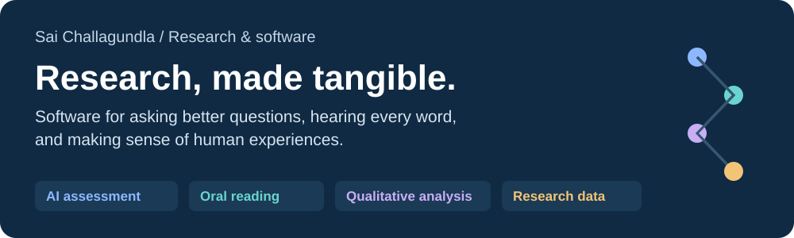
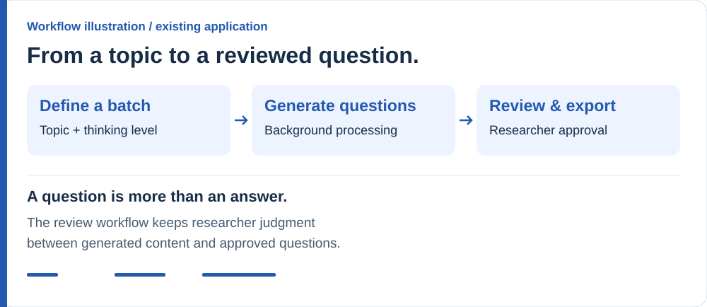
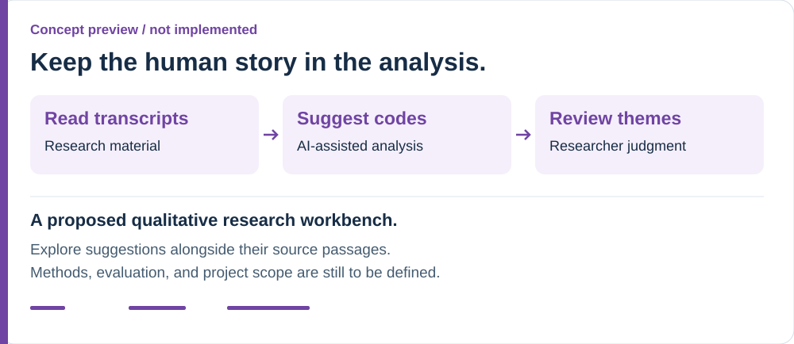

  

# Research software, with people at the center

I build software at the intersection of education, research, and AI: tools that help researchers review generated questions, inspect reading errors, and turn complex information into something they can use.

**Explore the work:** [AI assessment](#choa-lab) · [Oral reading](#first-grade-literacy-lab) · [Qualitative analysis](#emotions-equity-education-lab) · [Research data](#risk-resilience-culture-lab)

Two applications have existing code; two lab projects are future directions. The previews below illustrate workflows, rather than showing application screenshots.

## Choa Lab

### Bloom's Taxonomy Question Generation

Help researchers move from a topic and a desired thinking level to questions they can review, approve, and export.

**The software:** a researcher portal for submitting question batches, following progress, reviewing outputs, and exporting approved questions.

**The engineering:** a TypeScript API, Python workers, and PostgreSQL coordinate background jobs and recover from interrupted processing or duplicate delivery.

**Status:** application workflow implemented with a deterministic offline generation provider. A production model adapter remains planned; live AWS deployment is unverified.

[**Explore the code & setup**](https://github.com/s-chall/mcq-generation-blooms-taxonomy#readme) · [Architecture](https://github.com/s-chall/mcq-generation-blooms-taxonomy/blob/main/docs/architecture.md) · [Implementation evidence](https://github.com/s-chall/mcq-generation-blooms-taxonomy/blob/main/docs/resume-evidence.md) · [Lab context](choa-lab/)

---

## First Grade Literacy Lab

### Reading Error Engine

Help researchers understand how a child reads a passage by connecting word-level predictions to the audio evidence behind them.

**The software:** an oral-reading workbench for recording or uploading audio, inspecting flagged words, correcting predictions, and exporting reviewed sessions.

**The engineering:** React and FastAPI connect background assessment processing, versioned sequence-alignment pipelines, stored corrections, and cross-version evaluation.

**Status:** review workflow implemented. The browser speech recognizer is a transcript aid; a production child-speech recognition or forced-alignment integration remains open.

[**Explore the code & setup**](https://github.com/s-chall/reading-error-engine#readme) · [Workflow & architecture](https://github.com/s-chall/reading-error-engine#architecture) · [Lab context](first-grade-literacy-lab/)

---

## Emotions, Equity, Education Lab

### Qualitative Research Workbench · Proposed

Explore how AI could help researchers organize qualitative material while keeping source passages and human interpretation visible.

**The concept:** show suggested codes alongside the passages that support them, giving researchers a clear place to inspect and revise the analysis.

**Potential engineering focus:** structured AI outputs, source-linked suggestions, and researcher review workflows. These are design directions, not implemented capabilities.

**Status:** planned work. The lab's current proposal explores multi-agent qualitative analysis; scope, methods, and evaluation are still to be defined.

[**Explore the lab direction**](emotions-equity-education-lab/)

---

## Risk, Resilience, Culture Lab

### Research Data Explorer · Possible direction

A potential software project for helping researchers move from study data to clear visual comparisons and shareable outputs.

**The concept:** a visual workspace for checking data structure, exploring patterns, and preparing reproducible outputs.

**Potential engineering focus:** data validation, interactive visualization, and repeatable exports, subject to the lab's actual research workflow.

**Status:** exploratory concept, not an implemented or confirmed lab project. Research context, contributions, posters, and presentations are forthcoming.

[**Explore the lab context**](risk-resilience-culture-lab/)

---

## Behind the experience

The two existing applications separate interactive researcher workflows from longer background tasks. Their source repositories contain the full setup, implementation details, and limitations.

<strong>Read the architecture in plain language</strong>

**Question generation:** the portal submits a batch to the API. The database records the job and an outgoing event together. A publisher delivers that event to the queue; a Python worker generates and saves the result. The portal retrieves progress and outputs through the API for researcher review. The current provider is deterministic and offline.

**Reading analysis:** the interface submits a recording and transcript to the API. A background worker aligns the words and stores predictions. Researchers retrieve results, listen to evidence, and save corrections separately from the original predictions. Finalized sessions support export and evaluation across pipeline versions. The diagram summarizes processing and persistence; audio storage and playback are omitted for clarity.

These are component diagrams of existing software, not claims of a live deployment. The two proposed lab tools are intentionally outside this architecture.

## More of my work

[GitHub profile](https://github.com/s-chall) · [Hackathon prototypes](https://github.com/s-chall/hackathon-prototypes) · [Educational technology](https://github.com/s-chall/educational-technology) · [Data journalism](https://github.com/s-chall/data-journalism)

This repository is the portfolio directory. Application source code and research evidence live in the linked project repositories; lab folders provide supporting context and materials.
