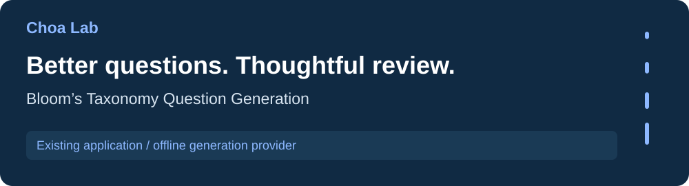
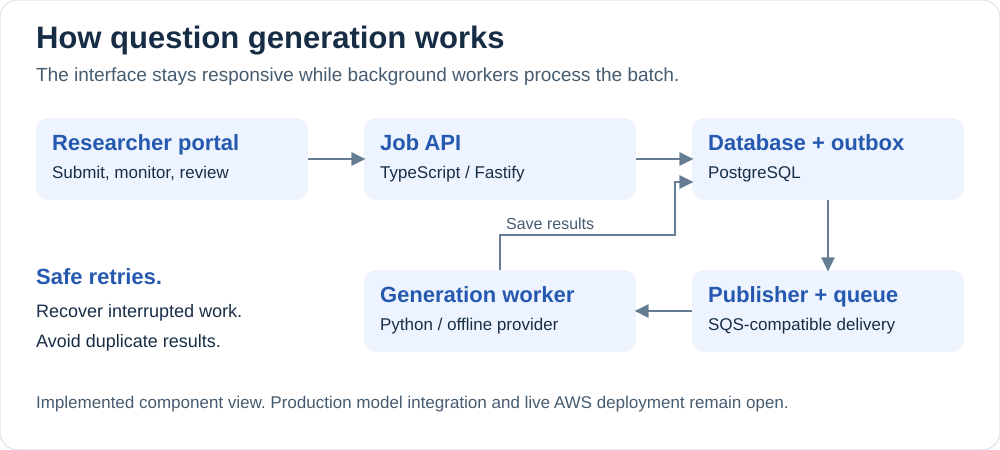

[Research portfolio](../) / Choa Lab

# Bloom's Taxonomy Question Generation

A question-generation and review platform for researchers studying educational assessment. Choose a topic and a thinking level, follow a batch as it processes, and review questions before exporting the approved set.

[**Explore the project**](https://github.com/s-chall/mcq-generation-blooms-taxonomy#readme) · [Research & publications](https://github.com/s-chall/mcq-generation-blooms-taxonomy/blob/main/docs/publications.md) · [Technical evidence](https://github.com/s-chall/mcq-generation-blooms-taxonomy/blob/main/docs/resume-evidence.md)

## The research problem

Writing useful multiple-choice questions takes more than producing a correct answer. Questions also need appropriate distractors and the right kind of thinking: recalling a fact is different from applying a concept or evaluating an explanation.

The associated study investigated generating introductory chemistry and biology questions at requested Bloom's Taxonomy levels, classifying those levels, and comparing automated quality checks with a teacher's review.

## A quick tour

| Researcher action | What the application does |
| --- | --- |
| Define a question batch | Registers source metadata and the requested Bloom targets. |
| Submit and follow progress | Creates a persistent job and processes its items in the background. |
| Review generated questions | Records researcher decisions through the review portal. |
| Export approved questions | Produces an output containing the approved items. |

## Behind the experience

The portal submits work through an API. The database records the job and its outgoing events together; a publisher delivers events to a queue, and workers generate and save results. Researchers retrieve progress and questions through the portal.

The reliability challenge is handling retries without losing work or producing duplicate results. Database transactions, request deduplication, and expiring worker leases support recovery when delivery repeats or a process stops midway.

<strong>Explore the implementation</strong>

| Layer | Technology | Read more |
| --- | --- | --- |
| Researcher interface | React, TypeScript | [Portal workflow](https://github.com/s-chall/mcq-generation-blooms-taxonomy/blob/main/docs/researcher-portal.md) |
| Job API | TypeScript, Fastify | [Requests and idempotency](https://github.com/s-chall/mcq-generation-blooms-taxonomy/blob/main/docs/api.md) |
| Durable state | PostgreSQL | [Schema and database decisions](https://github.com/s-chall/mcq-generation-blooms-taxonomy/blob/main/docs/database.md) |
| Background generation | Python, SQS-compatible delivery | [Workers and failure recovery](https://github.com/s-chall/mcq-generation-blooms-taxonomy/blob/main/docs/worker.md) |
| Deployment definition | Docker, Terraform, AWS | [Deployment guide and evidence boundary](https://github.com/s-chall/mcq-generation-blooms-taxonomy/blob/main/docs/aws-deployment.md) |

## What works today

The API, database, review portal, publisher, and worker are implemented. Integration tests exercise duplicate delivery, interrupted processing, expired leases, and provider failures.

**Current boundary:** generation uses a deterministic offline provider. A production model adapter, authentication, direct source upload, and automated evaluation screens remain planned. AWS infrastructure is defined and validated, but a live deployment has not been verified.

**Research evidence:** publication results are documented separately from the public demo data. The public fixtures do not reproduce the study's reported metrics. See [publication provenance](https://github.com/s-chall/mcq-generation-blooms-taxonomy/blob/main/docs/publications.md) and [data limitations](https://github.com/s-chall/mcq-generation-blooms-taxonomy/blob/main/docs/data-contract.md).

## Try it and go deeper

Start with the [project's local setup](https://github.com/s-chall/mcq-generation-blooms-taxonomy#run-the-public-analysis), then explore the [architecture](https://github.com/s-chall/mcq-generation-blooms-taxonomy/blob/main/docs/architecture.md) and [claim-by-claim implementation evidence](https://github.com/s-chall/mcq-generation-blooms-taxonomy/blob/main/docs/resume-evidence.md). The source repository also contains the research poster and publication references.

---

[All labs](../) · [Reading analysis](../first-grade-literacy-lab/) · [Qualitative analysis](../emotions-equity-education-lab/) · [Research data](../risk-resilience-culture-lab/)
