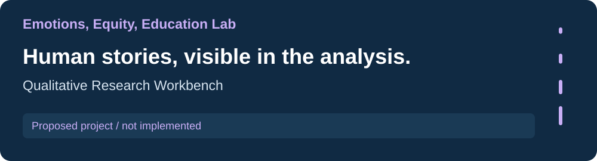
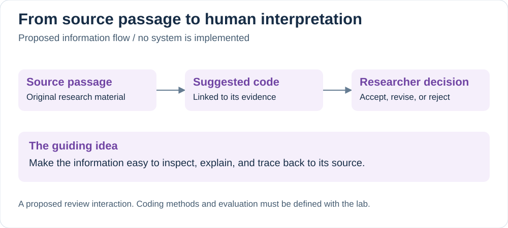

[Research portfolio](../) / Emotions, Equity, Education Lab

# Qualitative Research Workbench

A proposed tool for exploring qualitative material with AI assistance while keeping source evidence and researcher interpretation together.

**Project stage: proposed.** No application is implemented in this collection. The current direction explores multi-agent qualitative analysis; research scope, methods, and evaluation remain to be defined.

## The idea

Make a suggested code understandable by showing the passage behind it. Researchers would be able to inspect the source, consider the suggestion, and record their own interpretation.

The preview describes a possible interaction, not a validated research method or an existing interface.

## A concept preview

| Proposed interaction | Intended purpose |
| --- | --- |
| Read a source passage | Keep the original research material in view. |
| Inspect a suggested code | Make the connection between a label and its evidence visible. |
| Accept, revise, or reject | Give researchers a clear way to record their interpretation. |
| Revisit reviewed material | Explore how individual decisions contribute to emerging themes. |

## How the information could connect

The proposed flow connects each suggestion to its supporting passage and then to a human decision. Keeping these steps visible would help researchers inspect what was suggested and how the final interpretation was reached.

## What needs to be defined

| Decision | Why it matters |
| --- | --- |
| Research task and source material | Determines what a useful first version should support. |
| Coding approach and codebook | Defines the meaning of a suggestion and how it should be reviewed. |
| Evaluation method | Establishes how to assess usefulness and disagreement without treating an AI suggestion as ground truth. |
| Model and agent design | A multi-agent approach is a candidate; its value needs comparison with a simpler baseline. |
| Data handling and sharing rules | Determines what material can be processed and what examples can be public. |

## Potential engineering work

Source-linked structured outputs, a review interface, and traceable researcher decisions are possible implementation areas. No technology stack, benchmark, deployment, or completed feature is claimed here.

The next useful milestone is a scoped workflow and evaluation plan grounded in the lab's actual research, followed by a small working prototype using suitable sample material.

---

[All labs](../) · [AI assessment](../choa-lab/) · [Reading analysis](../first-grade-literacy-lab/) · [Research data](../risk-resilience-culture-lab/)
