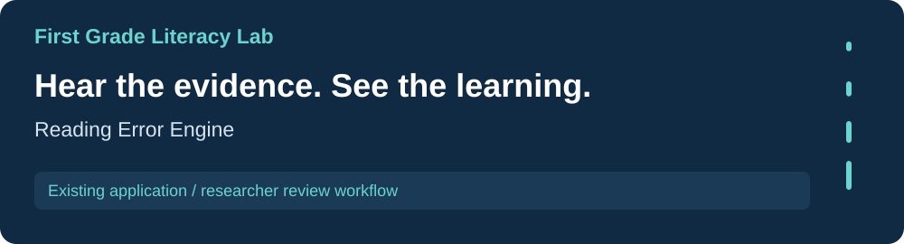
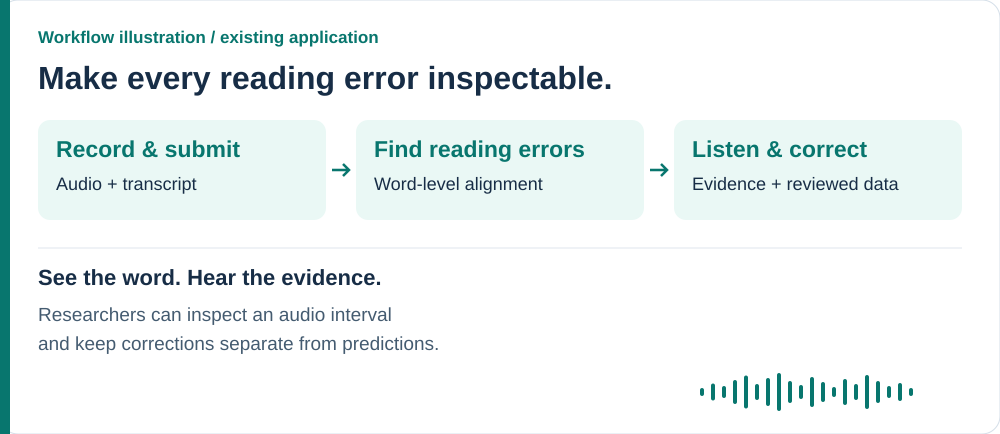
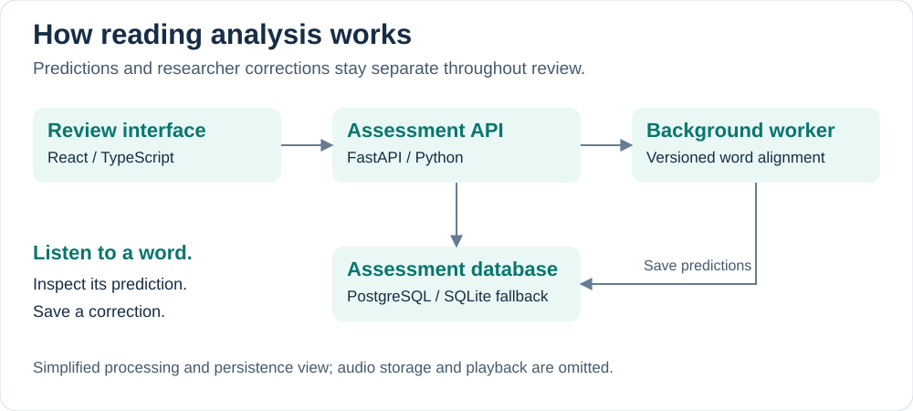

[Research portfolio](../) / First Grade Literacy Lab

# Reading Error Engine

An oral-reading analysis and review platform that connects a child's recording with word-level predictions. Researchers can listen to the evidence, correct an interpretation, and compare analysis pipelines on the same reviewed sessions.

[**Explore the project**](https://github.com/s-chall/reading-error-engine#readme) · [Architecture](https://github.com/s-chall/reading-error-engine#architecture) · [Run locally](https://github.com/s-chall/reading-error-engine#run-locally)

## The research problem

A reading error is easier to understand when the prediction and the original audio can be examined together. A skipped phrase, a repetition, and a word-order error represent different events; researchers need a practical way to inspect and correct them.

This project brings audio evidence, word alignment, researcher decisions, and pipeline comparison into one workflow.

## A quick tour

| Researcher action | What the application does |
| --- | --- |
| Record or upload a reading | Stores audio and queues a persistent assessment. |
| Inspect a flagged word | Shows the aligned prediction and plays its evidence interval. |
| Correct the result | Saves the error type, audio boundaries, and optional note separately from the prediction. |
| Finalize and export | Confirms reviewed labels and exports the session as CSV or JSON. |
| Compare pipeline versions | Evaluates versions on the same finalized sessions. |

## Behind the experience

The API queues an assessment so processing does not hold the upload request open. A background worker aligns the transcript and saves predictions; the interface checks progress and exposes failed assessments for retry.

Original predictions remain separate from researcher corrections. This makes it possible to revisit what a pipeline produced and compare different versions against reviewed labels.

<strong>Explore the implementation</strong>

| Layer | Technology | Responsibility |
| --- | --- | --- |
| Review interface | React, TypeScript | Audio intake, progress, evidence playback, corrections, and exports. |
| API and processing | FastAPI, Python | Assessment lifecycle, alignment, corrections, and evaluation. |
| Assessment data | PostgreSQL, SQLAlchemy | Sessions, versioned predictions, corrections, and evaluation runs. SQLite supports local use without database configuration. |
| Alignment pipelines | Sequence algorithms | A minimum-edit baseline and a context-aware version that recognizes repeated phrases and adjacent word-order errors. |

See the [API surface](https://github.com/s-chall/reading-error-engine#api-surface) and [architecture description](https://github.com/s-chall/reading-error-engine#architecture) in the application repository.

## What works today

The application supports intake, background processing, evidence playback, researcher correction, finalization, export, and cross-version evaluation. Regression fixtures cover skipped and repeated phrases, restarts, adjacent word swaps, misreads, audio-boundary constraints, and the complete review workflow.

**Current boundary:** the browser speech recognizer is a transcript aid, not ground truth. A production child-speech recognition or forced-alignment integration remains open. Word-level alignment results should be understood in the context of the supplied transcript and timestamps.

**Evaluation:** the application produces error-specific precision and recall through evaluation runs. It records processing latency and review timestamps; this page does not claim a measured accuracy or review-time improvement.

## Try it and go deeper

Follow the [local setup](https://github.com/s-chall/reading-error-engine#run-locally) to start the API and interface. PostgreSQL is supported; SQLite provides a simpler local fallback. Explore the [regression suite](https://github.com/s-chall/reading-error-engine#regression-suite) and [research measures](https://github.com/s-chall/reading-error-engine#research-measures) for verification and evaluation details.

---

[All labs](../) · [AI assessment](../choa-lab/) · [Qualitative analysis](../emotions-equity-education-lab/) · [Research data](../risk-resilience-culture-lab/)
