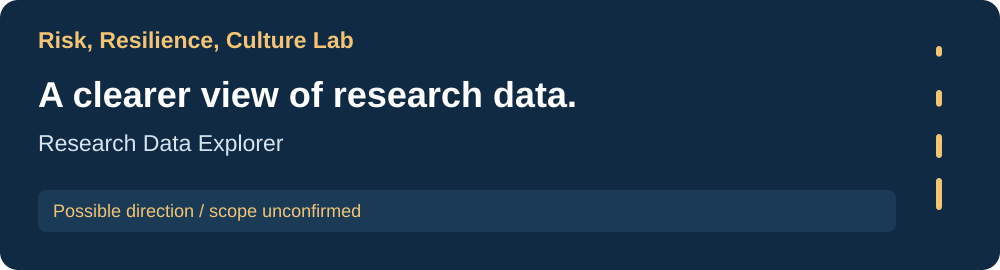
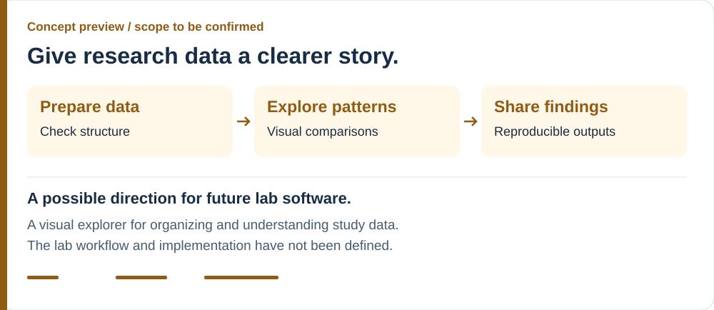
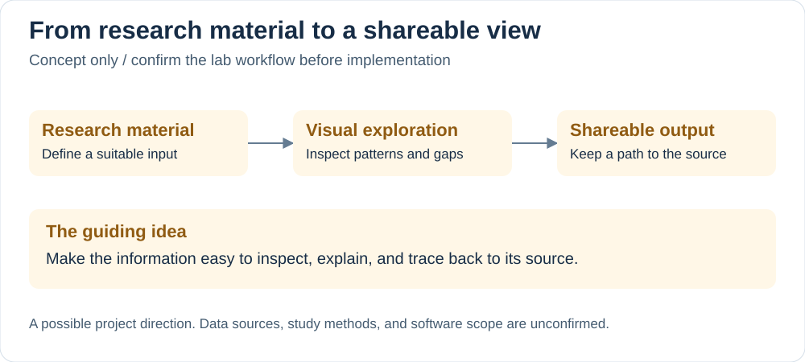

[Research portfolio](../) / Risk, Resilience, Culture Lab

# Research Data Explorer

A possible software direction for making research information easier to prepare, explore visually, and communicate.

**Project stage: exploratory concept.** This is not an implemented or confirmed lab project. Research context, individual contributions, posters, and presentations are forthcoming.

## The idea

Bring the path from research material to a shareable view into one understandable workflow. A researcher could inspect the input, explore appropriate comparisons, and trace an output back to its source.

The actual project should follow the lab's research questions and methods. This concept does not assume a particular dataset, survey design, or longitudinal study.

## A concept preview

| Possible interaction | Intended purpose |
| --- | --- |
| Prepare suitable research material | Make its structure and limitations understandable. |
| Explore a visual comparison | Help researchers inspect patterns and gaps. |
| Explain an output | Show what the view represents and which material it uses. |
| Share a reproducible result | Preserve the path from source information to an exported view. |

## How the information could connect

The diagram presents a possible information flow. It is a starting point for choosing useful software, rather than an architecture of an existing system.

## What needs to be defined

| Decision | Why it matters |
| --- | --- |
| Lab research question | Gives the software a specific purpose. |
| Available research material | Determines whether an explorer is appropriate and which inputs it could support. |
| Current manual workflow | Identifies a real task the software could improve. |
| Appropriate visual comparisons | Keeps the presentation grounded in the study's methods. |
| Public examples and outputs | Determines which materials can appear in this portfolio. |

## Potential engineering work

Data validation, interactive visualization, and repeatable exports are possible areas to develop once the lab workflow is confirmed. No specific stack, analysis result, completed feature, or deployed application is claimed here.

Research posters and slide decks are also planned for this lab directory. They will be linked when the materials and contribution details are available.

---

[All labs](../) · [AI assessment](../choa-lab/) · [Reading analysis](../first-grade-literacy-lab/) · [Qualitative analysis](../emotions-equity-education-lab/)
